# WindowPane

### A little window into any window.

Keep the part you care about in sight, without keeping the whole application in
front. Snip a region of a window and turn it into a **borderless, always-on-top
live pane**. Move it out of the way, fade it into your workspace, or remove a
background color entirely.

Native Windows. No embedded browser. No sign-in. No account or cookie access.

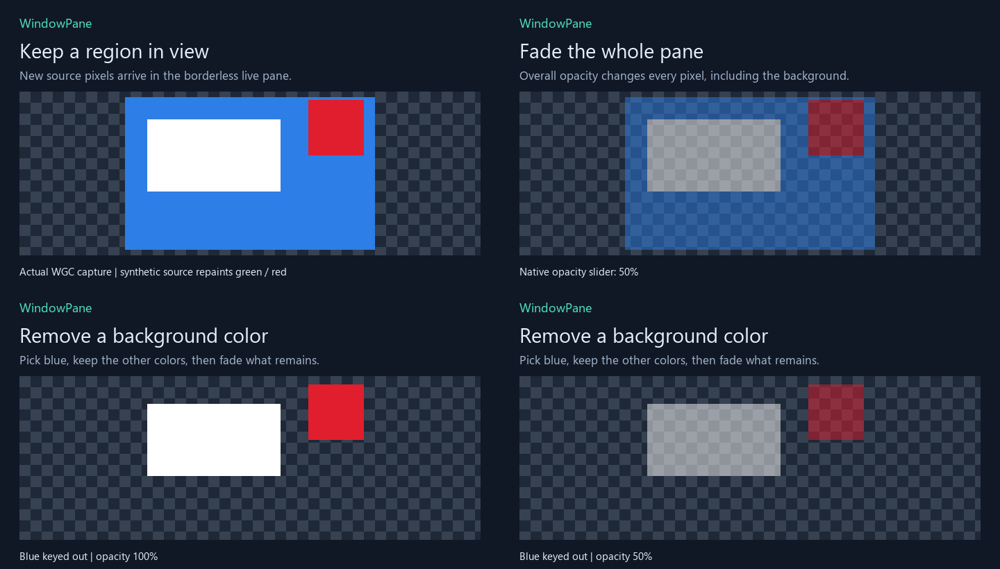

**Local preview:** one pane, session-only settings, unsigned executable.
There is no installer or published release yet.

[Get started](#get-started) · [Visual walkthrough](#visual-walkthrough) ·
[Controls](#controls-and-shortcuts) · [Screenshots](#screenshot-gallery) ·
[Limitations](#what-to-expect) · [Development](#development)

> **About the visuals:** all examples use our original synthetic test window,
> not a real account or private desktop. GIFs sequence actual native capture and
> compositor exports; they are paced demonstrations, **not mouse recordings or
> performance measurements**. Captions and checkerboards are documentation
> overlays, not chrome attached to the floating pane.

## What it does

| Feature | What you get |
|---|---|
| Snip a window region | Select just the area you want; cancel without replacing an existing pane |
| Stay above your workspace | A titlebar-free, always-on-top live view |
| Move and resize | Drag visible content, resize at an edge or corner, snap near work-area edges |
| Overall opacity | Fade the entire pane, background included |
| Picked-color transparency | Sample a background from the live pane and make matching pixels transparent |
| Tolerance and soft edges | Widen the color match and feather its boundary |
| Click-through | Let clicks reach the app underneath instead of moving the pane |
| Hide and recover | Tray controls, global shortcuts and an appearance reset |
| Adjustable update rate | 1, 5 or 10 fps; 5 fps is the default |
| Local-only operation | No network client, telemetry, browser integration or normal-operation recording |

For example, keep a small dashboard tile or progress indicator visible while
working elsewhere. WindowPane mirrors **pixels**, not the meaning of the
content. Compatibility with every source application is not established.

## Get started

### Run a local build

If you already built the project, launch:

```powershell
Start-Process .\build\Release\WindowPane.exe
```

Otherwise, on Windows x64, install Visual Studio 2022's **Desktop development
with C++** tools, **Windows SDK 10.0.26100.0**, and the **CMake component**, then
run from the repository root:

```powershell
.\scripts\build.ps1 -Test
Start-Process .\build\Release\WindowPane.exe
```

The script locates Visual Studio using `vswhere`; it does not install dependencies
or change security settings. **Exit WindowPane before rebuilding** so Windows
can replace its executable.

The app statically links the C++ runtime. Running the executable does not require
.NET, Electron, Node, Python, an extension or a separately downloaded application
framework. Python is used only by the optional documentation-media exporter.

The capture API baseline is Windows 10 version 1903. Qualification so far is
limited to the development machine; this is not a clean-machine compatibility
guarantee.

### Your first pane

1. Open the source application and make the desired content visible.
2. Click **Snip a window region**, or press **Ctrl+Alt+N**.
3. Start dragging inside that source window; release around the desired region.
4. Drag the resulting live pane into place. Its controls are separate, so the
   floating view has no permanent title bar or toolbar.

**Escape** or right-click cancels a snip. A successful new snip replaces the
current pane; cancelling keeps it.

## Visual walkthrough

### 1. Keep a live region in view

The source can sit behind other applications while WindowPane displays its
selected region. In this example, a patch in the synthetic source changes
between green and red; those updates arrive through Windows Graphics Capture.

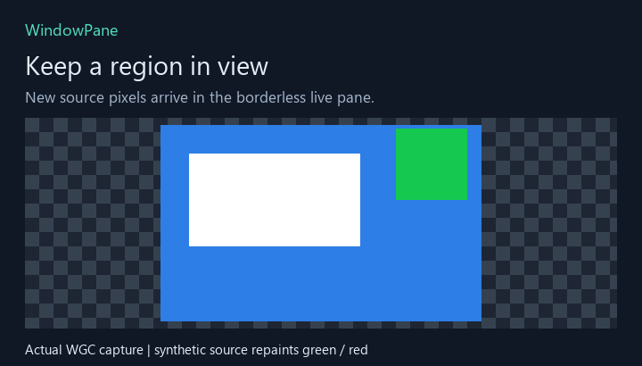

This is a fixed, window-relative rectangle. Moving the source window preserves
the selection; scrolling or changing the content changes what appears inside it.

### 2. Fade everything

Open controls with **Ctrl+Alt+O** and adjust **Opacity**. This changes every
captured pixel, including the background. The GIF sequences actual slider-handler
output from 100% down to 20% and back.

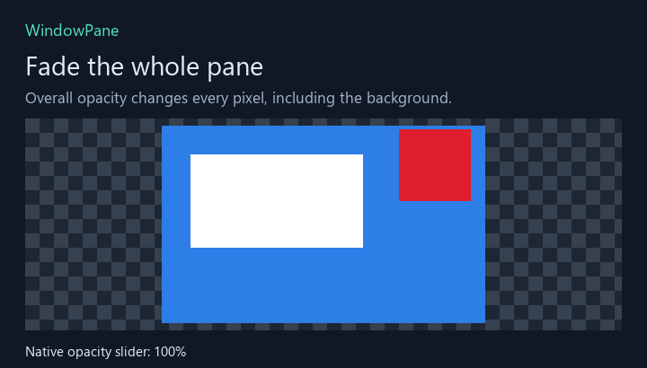

Use this when you want the entire pane to sit quietly over your workspace,
rather than remove a specific color.

### 3. Remove a background color

Choose **Pick from live pane**, then click the background inside the floating
view. While picking, WindowPane temporarily shows its unkeyed, fully opaque
source so you can sample a color that would otherwise be invisible.

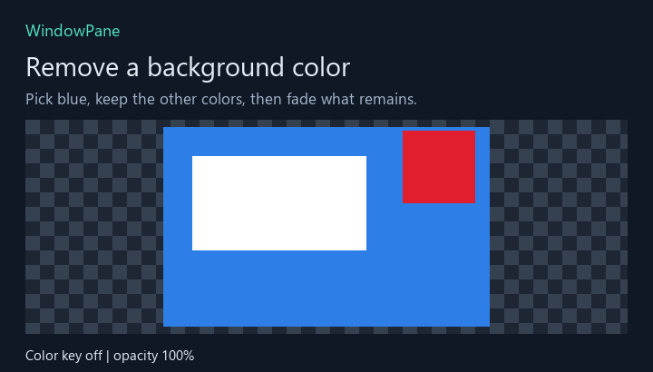

The three states above are **original → blue removed → blue removed with 50%
opacity**. White and red remain; the checkerboard marks transparent areas.

**Color tolerance** removes a wider range of nearby colors. **Soft edge**
gradually fades pixels just beyond that range. Escape cancels picking without
changing the previous color.

> Matching foreground pixels disappear too. Soft edges do not reconstruct text,
> remove every colored fringe, or perform perfect chroma-key cleanup.

### 4. Resize without stretching

Drag an edge or corner. The image keeps its proportions, with transparent
margins where the pane's shape differs from the selected crop.


Drag visible content to move the pane. Releasing near a monitor's work-area
edge snaps it into place. **Resizing the pane** scales the view; **resizing the
source window** invalidates the selection and requires a new snip.

## Controls and shortcuts

The separate controls window can close to the tray while the live pane remains.
These are captures of the actual controls, not mockups:

| Default appearance | Picking a color | Blue keyed out, opacity 50% |
|---|---|---|
|  | 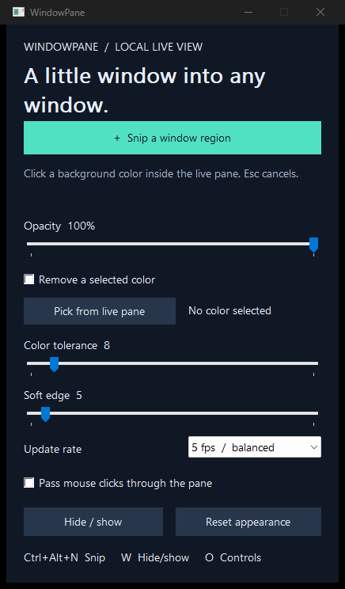 | 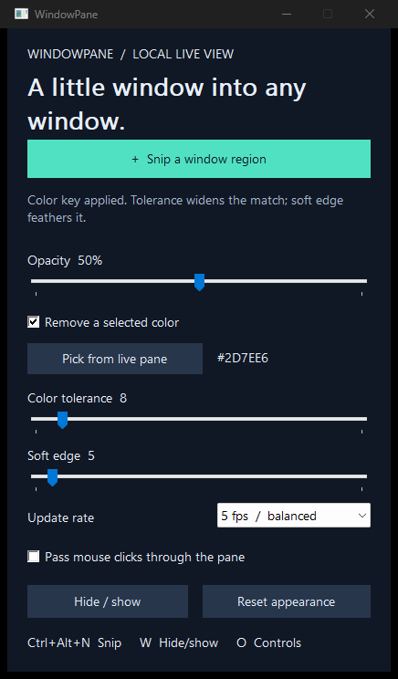 |

| Shortcut or action | Result |
|---|---|
| **Ctrl+Alt+N** | Snip a new region |
| **Ctrl+Alt+W** | Hide/show the pane |
| **Ctrl+Alt+O** | Open controls |
| **Escape** | Cancel snipping or color picking |
| Right-click the pane | Open the pane menu |
| Double-click the tray icon | Open controls |
| **Reset appearance** | Restore opacity, disable color removal and click-through, and show a hidden pane |
| **Exit WindowPane** in the menu | Stop the app; closing controls normally only hides them to the tray |

**Click-through** sends mouse input to the application *underneath* the pane.
It does not interact with or forward clicks to the captured source. Disable it
through controls before trying to drag the pane again.

At zero opacity or with fully transparent pixels, the pane may have nothing
clickable. Use **Ctrl+Alt+O**, the tray, or **Reset appearance** to recover.
Shortcut conflicts produce a visible warning; tray and controls remain available.

## Screenshot gallery

<details>
<summary><strong>Five still-image references: original, opacity, color removal, combined effects and aspect fit</strong></summary>

### Original captured region

Blue background, white patch and red update patch, captured from the owned
synthetic source. The documentation card is not part of the application.

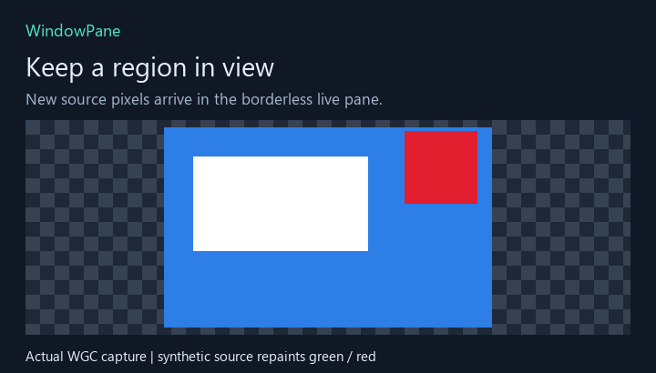

### Whole-pane opacity at 50%

All three colors fade. This is different from removing only the blue background.

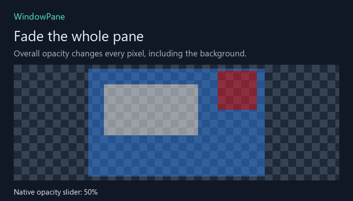

### Blue removed, foreground retained

The selected blue pixels are fully transparent; white and red stay opaque.

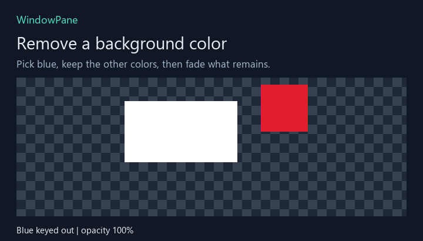

### Color removal plus overall opacity

Blue stays transparent while the remaining white and red are faded to 50%.

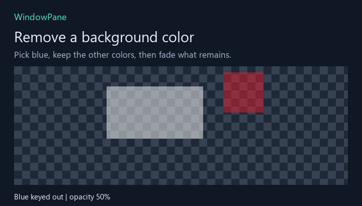

### A differently shaped pane

A 240 × 220 native output surface fits the 180 × 110 crop without distortion.
Its unused top/bottom margins are transparent.

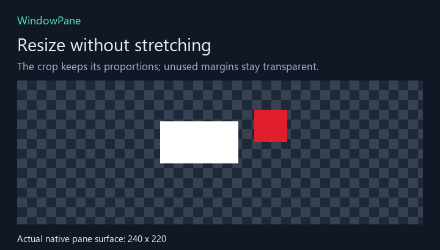

</details>

## What to expect

### A mirror, not a website client

WindowPane never signs in, reads values, scrapes pages or refreshes a website.
The source application remains responsible for updating its own data.

For a browser, the mirror follows the selected tab in that source window.
Switching tabs changes the pixels. It does not keep a background tab rendered
independently, and it does not track a particular number or card after scrolling.

### Source lifecycle

| Source state | WindowPane behavior |
|---|---|
| Open and rendering | Displays the latest received pixels |
| Moved | Keeps the crop relative to the source window |
| Minimized or hidden | Clears old pixels, shows an unavailable message; restore/show resumes |
| Resized | Stops the invalid crop and asks for a fresh snip |
| Closed | Stops capture and asks for a new source |
| Pane hidden through WindowPane | Releases capture; showing reconnects to the source |

Some applications stop rendering while inactive. Protected content can appear
black or unavailable. A received frame does not establish that the source's
underlying data is current.

### Privacy and capture boundaries

Windows captures the selected **source window** into GPU memory. WindowPane
reads back only the selected rectangle into CPU memory; it does not use a
whole-desktop capture fallback.

Normal operation saves neither captured frames nor settings. The explicitly
invoked synthetic documentation/test harness is separate and only exports its
owned fixture and controls. Windows may show its normal capture border;
WindowPane does not disable that indicator or bypass capture policies.

### Still outside this preview

Settings persistence, multiple panes, a signed package, an installer and
auto-start are not implemented. HDR fidelity, all application types,
mixed-DPI/multi-monitor combinations, exclusive fullscreen and secure desktops
are not qualified. Human usability acceptance is still pending.

### If something looks wrong

| Symptom | What to do |
|---|---|
| Pane is invisible or cannot be dragged | Open controls; reset appearance or disable click-through |
| Nothing updates | Check that the source is open, visible and actually rendering new content |
| Wrong content appears after scrolling or a tab change | Return the source to the intended content, or snip again |
| Source-resized message | Snip the region again at the new source size |
| Foreground disappears after picking a color | Reduce tolerance, choose a different key, or disable color removal |
| Colored fringes remain around text | Adjust tolerance/soft edge; perfect background reconstruction is not provided |
| Build cannot replace `WindowPane.exe` | Exit the running app through its menu, then rebuild |

## Development

WindowPane uses **C++20, Win32/C++/WinRT, Windows Graphics Capture, D3D11 and
premultiplied layered-window composition**. Its native executable is roughly
0.4 MB in the first local preview; that is not its total process memory usage.

The first bounded 180 × 110, 5 fps synthetic workload observed about 46 MB
working set and 0.62% CPU relative to one logical core. Those are local fixture
observations, not a performance budget; external DWM/GPU work is not included.
See the [verification notes](docs/04-development-and-verification.md) for scope.

| Read | For |
|---|---|
| [User guide](docs/01-using-windowpane.md) | Detailed selection, appearance, lifecycle and recovery behavior |
| [Architecture](docs/02-architecture.md) | Ownership, capture lifecycle, rendering and privacy boundaries |
| [Pixels and transparency](docs/03-pixels-and-transparency.md) | Coordinates, color distance, alpha and aspect-fit algorithms |
| [Development and verification](docs/04-development-and-verification.md) | Build, tests, native demo export and media reproduction |
| [Media provenance](docs/assets/README.md) | Which images are native exports and which are annotated derivatives |
| [Workstream index](TODO/00_INDEX.todo) | Bounded implementation and documentation work |
| [Development ledger](TODO/05_DEVELOPMENT_LEDGER.todo) | Decisions, failed approaches and observed outcomes |

All media is local to this repository. No third-party GIFs, private dashboard
captures or external image-hosting requests are required to read this guide.
