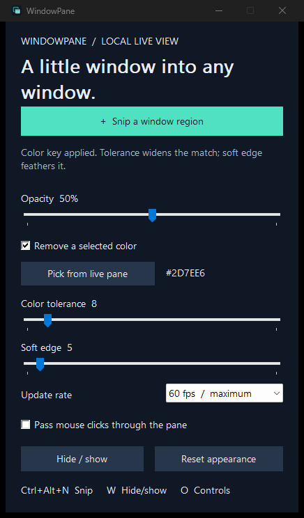
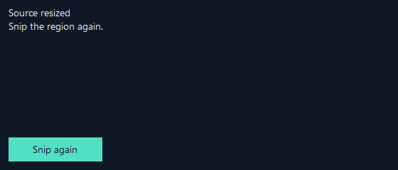

# 1. Using WindowPane

## Make a live pane

Open the source application and leave the desired content visible in its window.
Launch WindowPane and click **Snip a window region** (or Ctrl+Alt+N).
Drag from inside the desired source window across the region to mirror.
The selection is clipped to the window where the drag started. Release to
create the pane; Escape or right-click cancels.

The live view has no title bar or permanent toolbar. Drag the small dotted
upper-right corner grip, or interactive visible content, to move it; drag its
edges/corners to resize. Right-click the grip for options. Releasing near a monitor's work-area
edge snaps it into place. Resizing preserves image proportions with transparent
margins if the pane's shape differs from the crop.

This first preview has one pane. A successful new snip replaces the old one.
Cancelling preserves it; a failed/unsupported selection reports an error in the
controls. There is no persisted layout or session restoration.

## Fade the pane or remove a color

Right-click the corner grip and open **WindowPane controls**, or press Ctrl+Alt+O.
The separate controls window can be closed to the tray while the pane remains.

**Update rate** defaults to **60 fps**, the highest option. You can also choose
1, 5, 10 or 30 fps. This is a target, not a guaranteed output rate: source
rendering and Windows capture/timer scheduling can limit updates. Lower rates
reduce capture/readback/composition work.

**Opacity** fades all captured pixels. **Pick from live pane** temporarily
shows the unkeyed, fully opaque captured region and changes the pointer to a
crosshair. Click the background color inside that pane. The app samples its
captured source pixels, not a screen-wide screenshot. Escape restores the prior
appearance without applying a new key. The grip temporarily hides while picking
so it cannot obscure the source pixel being sampled.

**Color tolerance** removes a wider range of nearby colors. **Soft edge**
gradually fades pixels just beyond that range. This affects matching colors
anywhere in the crop, not only its background. White text over a blue card can
remain visible, but antialiased edge pixels may retain a blue fringe. This
preview does not reconstruct text or perform chroma spill correction.

*The controls shown were captured from WindowPane itself with an original
synthetic fixture. The source is not an authenticated account or live service.*

## Hide, click through and recover

- **Ctrl+Alt+W** or **Hide / show** toggles the pane. Hiding stops its capture
  session; showing reconnects to the original source.
- **Pass mouse clicks through the pane** lets the application underneath receive
  normal mouse input. WindowPane does not forward input to its captured source.
- **Ctrl+Alt+O**, tray double-click, or the tray menu opens controls.
- **Reset appearance** restores opacity, disables the color key and click-through,
  and shows a hidden pane if its source is still available.

The corner grip remains visible and interactive at zero content opacity, with
fully keyed pixels, and with click-through enabled. Left-drag it to move the
pane; right-click it for options. Enter/Space opens controls when the grip has
focus. Its translucent frosted-look tint is not live backdrop blur.
It hides with the pane and during snipping/picking.
If another application owns a shortcut, WindowPane warns at launch; use its
tray or visible controls instead. If no tray icon can be created, the app warns
and closing its controls exits rather than leaving an inaccessible process.

## What stays live

WindowPane follows pixels in a specific source window. That window may sit
behind other applications. Switching its browser tab changes the mirror;
closing the browser closes the source. Website data updates only if the
website itself updates. Scrolling moves content through the fixed crop.

Minimizing or hiding the source replaces the mirror with an unavailable
message; restoring/showing it resumes capture. Source closure stops capture.
Changing source-window dimensions invalidates the geometric crop and requires
a new snip. The **Snip again** button is shown directly in resized/closed-source
messages; click it, or focus the pane and press Enter/Space. It is labeled
**Snip** in very small panes. Click-through is temporarily suspended for these
recovery messages so the action remains accessible.
The grip also hides if it would overlap the recovery button in a tiny pane.

Cancelling that selection preserves the unavailable-state message instead of
trying to capture a closed source or reuse an invalid crop. A successful new
snip removes the recovery button; normal live content remains titlebar-free
with no permanent toolbar. Display/DPI/layout changes can also require re-selection.

Protected content may be black or unavailable. Some applications stop rendering
while inactive. Static pixels or a successfully received frame do not establish
that a source application's underlying data is current.
