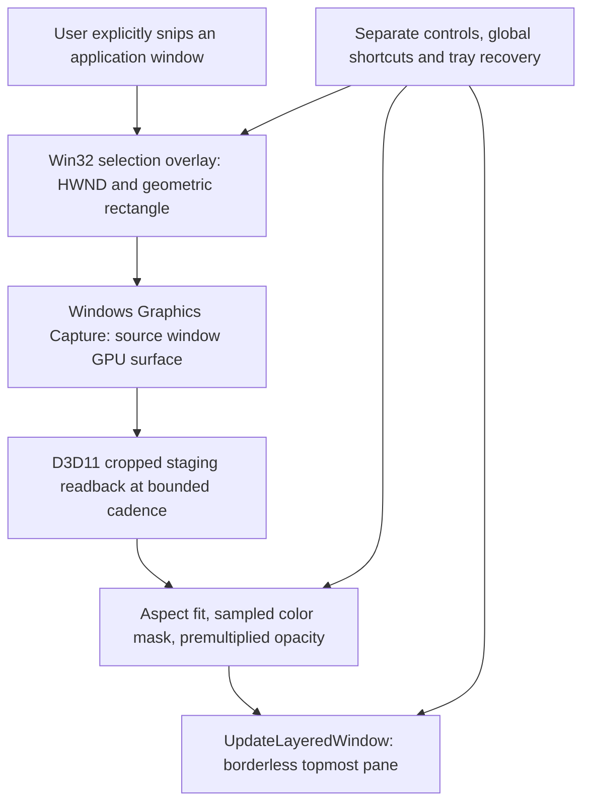
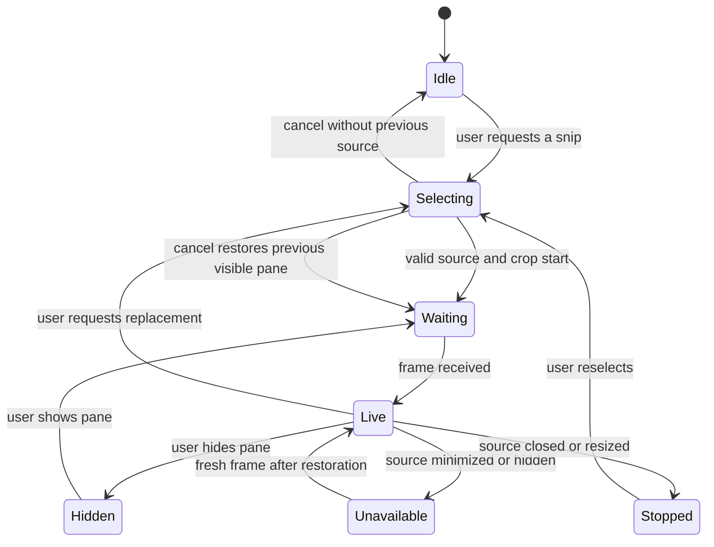

# 2. Architecture and design boundaries

## One native process, three visible surfaces

The diagram describes implemented data/control flow. Windows captures a source
**window**, not just the rectangle, into GPU memory; the app copies only its
selected crop into CPU memory. No whole-display capture fallback exists.

`src\app.cpp` owns the manager, selector, live pane, tray, shortcuts and message
loop. `Capture` in `src\capture.hpp` / `src\capture.cpp` owns the WGC session,
two-frame pool, D3D11 device/context and staging texture. `src\pixels.cpp` holds
platform-independent crop, color, aspect-fit and alpha transformations.

## Capture lifecycle

Selection temporarily stops the previous session and hides the pane and
manager. The drag's starting window is resolved while the selection overlay is
briefly hidden. The rectangle is clipped to that window's DWM extended frame
bounds, in physical screen pixels. Per-monitor-v2 awareness avoids implicit DPI
virtualization. Broad mixed-DPI qualification remains separate from this design.

The free-threaded frame pool is polled on the UI timer, not handled through a
high-frequency application frame callback. The newest queued frame replaces
older ones. On supported OS versions, `MinUpdateInterval` also requests the
chosen cadence from Windows; older versions may still produce frames more
frequently than WindowPane reads them.

A capture-size discrepancy alone is not treated as a permanent user resize:
minimize/restore animations can leave transient differently sized frames queued.
`Capture::Poll` first compares the normal source-window geometry, and discards
transient mismatched frame sizes. This distinction fixed the first native
minimize/restore regression.

## Design principles that matter here

**Data-source independence.** The app mirrors rendered pixels; it does not
understand websites, consumption values, authentication or refresh buttons.
This keeps account credentials in the original application but requires that
application to remain open.

**Pure transformations at the test boundary.** Geometry, alpha and masking have
small platform-independent functions. Native tests separately cross the actual
capture, input-handler and desktop-compositor boundaries.

**Single ownership and RAII.** A capture object owns the session and its graphics
resources. Replacing/hiding it destroys that ownership. `Surface` owns its DC,
DIB and selected-bitmap restoration. Captured frames are not retained after GPU
copy/readback; only the current cropped CPU buffer remains for rendering/picking.

**Recovery independent of content.** Pane controls are deliberately separate:
fully transparent or click-through content cannot be its own sole recovery
surface. The manager, global shortcut and tray remain available.

**Visible failure, no desktop fallback.** Capture errors appear in controls and
emit diagnostic debugger text. Unavailable sources replace old pixels with a
message. Device/capture failure does not trigger a screen scrape, policy change
or hidden authentication attempt.

## Privacy and platform boundaries

Normal operation writes no frames or configuration to disk and includes no
application network code. The explicit `--self-test` path exports only original
synthetic outputs and a metadata report. It refuses to start capture if its
selected HWND is not its own fixture. Its two desktop-composition sample points
are guarded against unrelated windows before pixels are inspected.

The app is not a sandbox or security product. It can display sensitive pixels
from a window the user selects. Other screen-sharing software may see its pane.
It does not suppress Windows' capture indicator or bypass protected surfaces.
Unsigned local-preview status is not a security certification.

Official API references:

- [Windows Graphics Capture overview](https://learn.microsoft.com/en-us/windows/apps/develop/media-authoring-processing/screen-capture)
- [CreateForWindow](https://learn.microsoft.com/en-us/windows/win32/api/windows.graphics.capture.interop/nf-windows-graphics-capture-interop-igraphicscaptureiteminterop-createforwindow)
- [UpdateLayeredWindow](https://learn.microsoft.com/en-us/windows/win32/api/winuser/nf-winuser-updatelayeredwindow)
