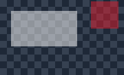

# 3. Pixels, coordinates and transparency

The implementation is in `src\pixels.hpp` and `src\pixels.cpp`, with focused
cases in `tests\pixels_tests.cpp`. These are simple per-pixel transformations,
not AI segmentation or semantic anchoring.

## Selection coordinates

`SelectRect` normalizes a drag in any direction and intersects it with the
source-window bounds. Negative coordinates are valid on monitors left/above
the primary monitor. The app subtracts the source's physical DWM bounds origin
to obtain the capture-relative rectangle.

`ValidCrop` requires at least 8 pixels and at most 4096 pixels per crop side,
with no negative origin or out-of-frame extent. Readback uses a staging texture
the size of this crop, rather than copying the whole source into a CPU bitmap.

Moving a source does not change window-relative coordinates. Resizing, scrolling
and layout reflow do not preserve semantic content; this is a geometric view.

## Aspect-fit sampling

For source width/height `sw, sh` and pane width/height `dw, dh`:

```text
scale = min(dw / sw, dh / sh)
fitted size = floor(source size * scale), with a minimum of one pixel
margin = (pane size - fitted size) / 2
source pixel = floor(destination coordinate within fitted area / fitted size * source size)
```

The preview uses nearest-neighbor sampling. It does not distort the crop to fill
a different-shaped pane; unused margins are transparent. `Sample` uses exactly
the same mapping in reverse so a picked color comes from the original capture,
not a blended/composited screen pixel.

The UI refuses a pick in a transparent aspect-fit margin and invites another
click. It does not sample the application underneath.

## Color distance and soft keying

Pixels are BGRA. Source capture pixels are treated as premultiplied alpha.
For comparing a partially transparent source pixel, `StraightColor` first
unpremultiplies RGB and handles zero alpha without division.

The key distance is the largest absolute RGB channel difference, normalized to
0..100. This deliberately inexpensive metric gives the tolerance slider a
predictable channel threshold:

```text
d = 100 * max(abs(r-keyR), abs(g-keyG), abs(b-keyB)) / 255

coverage = 0                          if d <= tolerance
coverage = 1                          if softness is zero and d > tolerance
coverage = min(1, (d-tolerance)/softness) otherwise
```

Keying is optional. Exact matching works with tolerance=0 and softness=0.
Increasing tolerance removes more colors; softness fades a band beyond that
threshold. There is no foreground/background classification: matching text,
icons and chart lines disappear as well.


*Actual WGC pixels from the original native fixture before applying a key.*



*Blue pixels have zero coverage; the remaining white/red pixels have half
opacity. A derived checkerboard makes that alpha visible in this document.*

## Premultiplied-alpha invariant

Let `f = coverage * opacity / 100`. Apply it once to every already-premultiplied
source channel and its alpha:

```text
outB = round(sourceB * f)
outG = round(sourceG * f)
outR = round(sourceR * f)
outA = round(sourceA * f)
```

Do not multiply RGB by source alpha a second time. A half-transparent pixel
would darken incorrectly. `UpdateLayeredWindow` receives `AC_SRC_ALPHA`,
constant alpha 255, and the composed DIB.

Soft keying changes alpha, not the original edge color. Colored fringes from
antialiased text can remain. HDR/tone mapping and chroma-spill correction are
not implemented in the SDR BGRA preview.

## Cost and bounds

CPU composition is `O(pane width * pane height)` time and output storage.
Readback copies `O(crop width * crop height)` bytes. A latest-frame buffer and
composition DIB are retained; Windows also owns capture surfaces for the source
window. Source-window size, monitor/GPU and app activity affect resource use.

Interactive resizing is capped at 2048 pixels per pane side; image functions
defensively reject dimensions over 4096. Default polling is 5 fps, adjustable to
1 or 10 fps. Hiding the pane releases the capture session.

The first implementation favors small, understandable native code over a
custom GPU shader pipeline. A future measured bottleneck could justify moving
the same alpha rules into a shader without changing their semantics.
